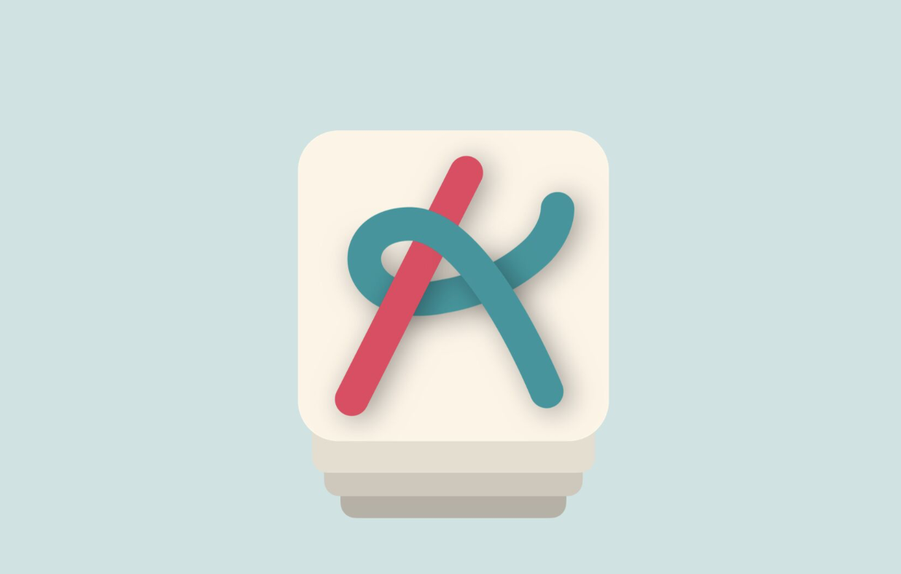

# Alinha

A queue management iOS app built collaboratively by a team of 30 people as part of an intensive Agile project. The app connects students and mentors, allowing students to enter a support queue with a description of their problem, and mentors to manage and attend to those requests in real time.

My main responsibility was **frontend development**, with focus on the **tvOS platform**, and also contributing to **frontend–backend integration**.

---

## About the Project

This project was developed over one month using **Scrum** methodology, with a cross-functional team of 30 people spanning iOS, tvOS, macOS, and backend. It was an intense and enriching experience focused on team collaboration, agile organization, and technical growth.

**Technologies:** SwiftUI · SwiftData · Push Notifications · REST API

---

## Features

- **Login & authentication** — email/password login with session persistence via SwiftData
- **Account creation** — sign up flow with name, email, password, and confirmation validation
- **Queue entry** — students describe their problem, select a category (doubt/problem) and track (code/design/undefined), and join the queue
- **Queue view** — role-based view that renders different interfaces for students, mentors, and admins; auto-refreshes every 1.5 seconds
- **Profile page** — displays user name, email, and avatar; supports icon change and password edit
- **Icon picker** — grid of 8 selectable avatars saved with SwiftData
- **Push notifications** — device token registered on launch and sent with queue appointments so mentors can notify students
- **Log out** — clears the SwiftData session and returns to login

---

## Requirements

- **Xcode** 16 or later
- **iOS** 18 or later
- **Swift** 5.9 or later
- A **physical device** is required for push notification registration and delivery
- A running **backend server** is required for login, account creation, and queue endpoints

---

## Running the Project

1. Clone or download the repository
2. Open the `.xcodeproj` file in Xcode
3. Enable the **Push Notifications** capability in the app target settings
4. Configure the backend base URL in `RoutesRequisition` to point to your server
5. Select a physical device and press **Run (⌘R)**

> Push notifications will not work on the simulator. A physical device with a registered APNs token is required.

---

## Project Structure

```
Front/
├── FrontApp.swift              # App entry point, push notification setup
├── ContentView.swift           # NavigationStack root with route enum (Login, Profile, CreateAccount)
├── LoginView.swift             # Login screen; redirects to QueueView if already logged in
├── CreateAccountView.swift     # Sign up form with validation
├── QueueView.swift             # Role-based queue view, polls API every 1.5s
├── ProfileView.swift           # User profile: avatar, name, email, logout
├── SheetEnterQueue.swift       # Sheet to enter the queue with description, type, and category
├── SheetEditProfile.swift      # Sheet to edit username and password
└── SheetEditIcon.swift         # Sheet with avatar grid picker saved to SwiftData
```

---

## Architecture

- **SwiftData** is used for local session persistence — the `User` model stores the logged-in user's info and icon across sessions
- **NavigationStack + AppRoute enum** handles programmatic navigation between Login, Profile, and CreateAccount
- **PushManager** (singleton) registers the device on launch and exposes the APNs token hex string for use in API calls
- Queue data is fetched from a REST API via `RoutesRequisition` and refreshed automatically using a `Timer`

---

## My Contributions

- Frontend development for the **tvOS platform**
- Integration between **frontend and backend** (API calls, push notification token flow)
- Participation in Scrum ceremonies and cross-team collaboration across a 30-person project

## Connect

[](https://www.linkedin.com/posts/thais-cangu%C3%A7u-0474392b6_swiftui-scrum-frontend-activity-7370915879175335937-SkiN?utm_source=share&utm_medium=member_desktop&rcm=ACoAAEvh__cB23N7yZmSu8VwG2oD2ecg-z5fOFs)
