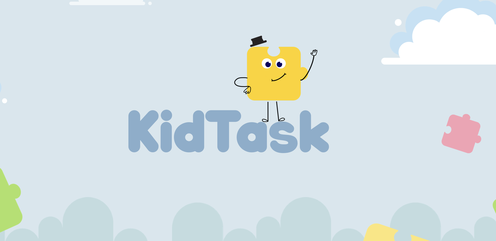

<p align="center">
  
</p>

# Kid Task

> 13th Campus Mobile Competition Finalist (Instituto Claro)

Kiddy Task is an iOS application designed to help children with Autism Spectrum Disorder (ASD) actively participate in household routines. By prioritizing predictability and visual support, the app features an accessible and friendly interface focused on fostering autonomy. 

This project was developed during the 13th edition of the Campus Mobile competition, where our team refined the concept through high-level mentorship, aiming to ensure technology serves as a true ally for inclusion.

**Created by:** Camila Parolin, Matheus Motta, and Thais Canguçu

---

[](https://www.linkedin.com/posts/thais-cangu%C3%A7u-0474392b6_autismo-tea-desenvolvimentoios-ugcPost-7458577238553407489-AHM9?utm_source=share&utm_medium=member_desktop&rcm=ACoAAEvh__cB23N7yZmSu8VwG2oD2ecg-z5fOFs)

---

## About the Project

Routine can be challenging, but structure makes it lighter. In Kiddy Task, daily activities are organized clearly so children can anticipate and collaborate with their families. The app uses a secure caregiver gateway, photo-based evidence of completed tasks, and a visual puzzle-piece reward system to encourage positive reinforcement without overwhelming the child.

## Core Features

| Feature | Description |
|-------------|---------|
| Visual Routines | Clear, structured tasks that help transform daily chores into a collaborative family effort. |
| Photo Evidence | Uses `PhotosPicker` and a custom `UIImagePickerController` to capture "after" photos of completed tasks. |
| Caregiver Gateway | Password-protected sections to validate task completion and manage difficulty levels, ensuring a safe environment. |
| Puzzle Rewards | A custom visual reward system where children collect puzzle pieces to track their progress toward a goal. |
| Memory Book | An interactive 3D openable book to review past achievements and positive memories. |

## Technical Highlights

- **SwiftUI & UIKit Integration** — Fluid interfaces built with SwiftUI, seamlessly integrating UIKit components like `UIImagePickerController` via `UIViewControllerRepresentable`.
- **Persistent State** — Employs `CoreData` for saving tasks, rewards, and images locally, along with `@AppStorage` for onboarding and caregiver credentials.
- **Custom Animations** — Includes complex geometric readers and 3D rotations (`rotation3DEffect`) to create a realistic page-turning effect for the Memory Book.
- **Accessibility First** — Designed with clear typography, high-contrast colors, and large touch targets to accommodate neurodivergent users.

## Requirements

- **Xcode** 15 or later
- **iOS** 16.0 or later
- **Swift** 5.0 or later

## Running the Project

1. Clone or download the repository.
2. Open the project in Xcode.
3. Ensure all custom fonts (e.g., "Qilka") and image assets (e.g., "WelcomeBG", "leftPiece", "Union", "book") are properly linked in the project.
4. Select a simulator or physical device and press **Run (Cmd+R)**.
5. On the first launch, you will be prompted to set up the caregiver and child profiles, including a master password.

## Project Structure

```text
KiddyTask/
├── ContentView.swift             # Main entry point managing TabView and first-time onboarding
├── WelcomeView.swift             # Onboarding form for profile and password setup
├── TaskView.swift                # Task validation screen requiring photo and caregiver password
├── RewardsView.swift             # Puzzle-based gamification and milestone tracker
├── OpenableBook.swift            # 3D interactive memory book view
├── CameraPicker.swift            # UIKit wrapper for native camera integration
└── UI Components/
    ├── doneTaskPage.swift        # View for reviewing a completed task
    ├── leftPiece.swift           # Custom UI for reward progression
    └── rightPiece.swift          # Custom UI for reward progression
