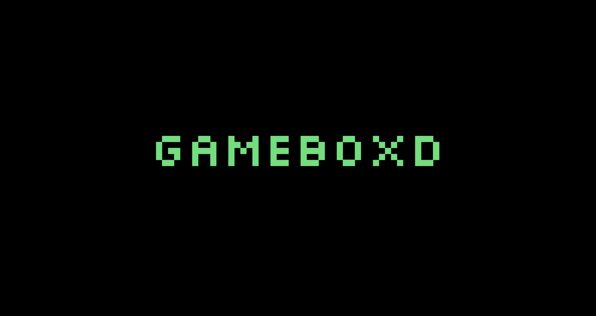

# Gameboxd 🎮

A Letterboxd-inspired iOS app for gamers — built with SwiftUI as a UI/UX learning project. Gameboxd lets users discover games, read and write reviews, track their gaming activity, and manage a personal profile, all with an interface modeled after the popular film-tracking app Letterboxd.

**Created by:** Thais Canguçu & Andre Lima Contarelli

---

## About the Project

This app was developed as a hands-on opportunity to learn **iOS UI development with SwiftUI**. The challenge was to recreate the Letterboxd experience — its layout, navigation patterns, and visual style — but reimagined around video games instead of films.

---

## Features

- **Home** — Browse popular games this week, new releases from friends, and popular with friends, with horizontal scroll carousels
- **Search** — Find games, studios, characters and reviews; filter by genre, platform, release year, game mode, and more
- **Activity** — Track what friends are playing, see liked reviews, with Friends / You / Incoming tabs
- **Profile** — View favorites, recent activity, and a personal ratings bar chart
- **Game Page** — Individual game view with cover art, background image, description, trailer button, platform info, and a ratings distribution chart
- **Reviews** — Community reviews with star ratings, cover art, and written impressions
- Reusable components: `FiveStars`, `BarChart`, `DividerLine`
- Custom `Silkscreen` font for the Gameboxd branding

---

## Requirements

- **Xcode** 15 or later
- **iOS** 17 or later
- **Swift** 5.9 or later

---

## Running the Project

1. Clone or download the repository
2. Open the `.xcodeproj` or `.xcworkspace` file in Xcode
3. Add your game cover images to the **Assets** folder. The app currently references:
   - `Minecraft`
   - `tlou` / `tlou2`
   - `tlou-background`
   - `gta`
   - `readdead`
   - `Undertale`
4. Add the **Silkscreen** font files to the project and register them in `Info.plist` under `UIAppFonts` (the font is already referenced in the code as `Silkscreen-Regular` and `Silkscreen-Bold`)
5. Select a simulator or connected device and press **Run (⌘R)**

---

## Project Structure

```
Gameboxd/
├── LetterboxdApp.swift   # App entry point
├── ContentView.swift     # TabView with 5 tabs
├── HomePage.swift        # Home feed (Games, Reviews, Lists, Journal)
├── Games.swift           # Horizontal game carousels
├── Reviews.swift         # Friend reviews feed
├── SearchPage.swift      # Search + browse filters
├── ActivityPage.swift    # Friend activity feed
├── ProfilePage.swift     # User profile, favorites, recent activity
├── GameTab.swift         # Individual game detail page
├── LogPage.swift         # Log entry page (placeholder)
├── Settings.swift        # Settings page (placeholder)
├── BarChart.swift        # Ratings distribution chart (Swift Charts)
├── FiveStars.swift       # Reusable 5-star rating component
├── DividerLine.swift     # Reusable divider component
└── Data.swift            # Data model for chart entries
```

---

## What We Learned

- Building multi-tab navigation with `TabView` and `NavigationStack`
- Creating reusable SwiftUI components
- Working with `ScrollView` (vertical and horizontal)
- Using `Swift Charts` for data visualization
- Applying custom fonts in SwiftUI
- Layout techniques with `HStack`, `VStack`, `ZStack`, and `GeometryReader`
