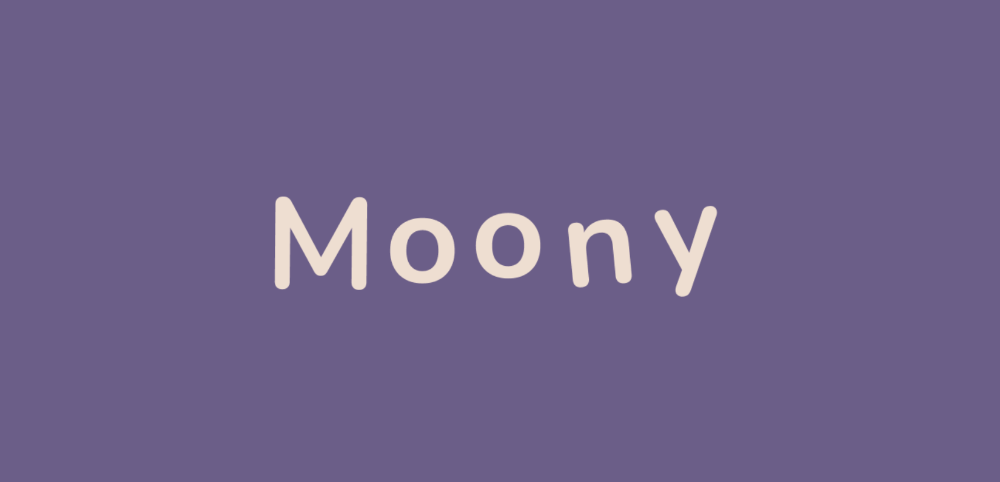

<p align="center">
  
</p>

# Moony

> Available on the App Store: [Download Moony](https://lnkd.in/gyQySHMg)

Moony is an iOS app designed to help children with hypersensitivity and/or ASD (Autism Spectrum Disorder) cope with sound overload. By providing early exposure to sounds from unfamiliar environments, Moony allows children to explore and familiarize themselves at their own pace — before facing those environments in real life.

This was my **second app published on the App Store**, developed over 9 weeks together with my team.

**Created by:** Thais Canguçu, Jonas Melo, Isabela Hissa Pinto, Kleber Gadelha & Alana Abdias de Oliveira Macedo

---

[](https://www.linkedin.com/in/thaiscangucu)

---

## About the Project

Moony presents interactive scenes built with **SpriteKit** where children can drag objects around the screen to trigger their corresponding sounds. Each object interaction is gentle and rewarding — unlocking new objects as the child engages more, always with haptic feedback and progressive exposure in mind.

The app also supports **Assistive Access**, Apple's simplified interface mode designed for users with cognitive disabilities.

---

## Environments

| Environment | Objects |
|-------------|---------|
| ✂️ Barbershop | Scissor, Shaver, Blow Dryer, Shower |
| ✈️ Airport | Luggage, Speaker, Plastic, Airplane |
| 🔒 Coming Soon | 3 more environments planned |

Each environment has 4 interactive objects. Objects are progressively unlocked as the child drags and interacts with the available ones.

---

## Features

- **Drag-and-drop sound interaction** — dragging objects across the SpriteKit scene plays their real-world sound
- **Progressive unlocking** — new objects unlock as the child interacts with existing ones (drag an object 3 times to reveal the next)
- **Social Story** — a swipeable illustrated intro to the barbershop environment that plays each object's sound as the child reads through it
- **Haptic feedback** — custom haptic patterns using `CoreHaptics` for object pickup, drop, and unlock events
- **Objectives page** — shows the child's progress for each object in the current environment
- **Assistive Access support** — a dedicated simplified interface (`AssistiveAccessContentView`) for users with cognitive disabilities
- **Onboarding sheet** — animated tutorial shown on first launch explaining how to interact with objects
- **Persistent state** — object positions and unlock progress saved with Core Data across sessions
- **Custom Nunito font** throughout the UI

---

## Requirements

- **Xcode** 16 or later
- **iOS** 18 or later
- **Swift** 5.9 or later
- A **physical device** is recommended for haptic feedback testing

---

## Running the Project

1. Clone or download the repository
2. Open the `.xcodeproj` file in Xcode
3. Make sure the following are included in the project:
   - Core Data model file (`C8.xcdatamodeld`) defining the `Objeto` entity
   - All SpriteKit scene assets (object images, background images, animated textures prefixed with `T`, locked state prefixed with `L`, and container prefixed with `C`)
   - Audio files for each object sound
   - The **Nunito** font family registered in `Info.plist` under `UIAppFonts`
4. Select a simulator or device and press **Run (⌘R)**

---

## Project Structure

```
Moony/
├── C8App.swift                       # App entry point; registers both standard and Assistive Access scenes
├── ContentView.swift                 # Home screen with environment selection grid
├── AmbientView.swift                 # SpriteKit environment view (standard mode)
├── CabeleleiroACView.swift           # Barbershop view for Assistive Access mode
├── AssistiveAccessContentView.swift  # Simplified home for Assistive Access users
├── HistoriaSocialView.swift          # Social story: illustrated swipeable intro with sounds
├── ObjetivosView.swift               # Progress/objectives page per environment
├── OnBoardingSheet.swift             # Animated onboarding overlay shown on first launch
├── SceneViewModel.swift              # GenericScene: SpriteKit scene logic (standard mode)
├── SceneACViewModel.swift            # GenericACScene: SpriteKit scene for Assistive Access
├── ObjectsMechanicsViewModel.swift   # Object unlock logic and sound trigger tracking
├── CoreDataViewModel.swift           # CRUD operations and progress state for Core Data
└── HapticsViewModel.swift            # CoreHaptics patterns for pickup, drop, and unlock
```

---

## How the Unlock System Works

Each environment starts with the first object available. The child drags copies of that object into the scene; after **3 drags**, the next object unlocks and appears in the tray. This progressive exposure model ensures children build familiarity gradually, without being overwhelmed. Unlock state is persisted in Core Data so progress is saved between sessions.

---

## What We Learned

- Building interactive scenes with **SpriteKit** (touch handling, animations, node management)
- Implementing **progressive unlocking** mechanics tied to Core Data state
- Creating custom **haptic feedback** patterns with `CoreHaptics`
- Supporting **Assistive Access** — Apple's simplified UI mode for users with cognitive disabilities
- Designing for **accessibility and neurodivergent users** from the ground up
- Coordinating a multi-person team project over 5 weeks with Agile practices
