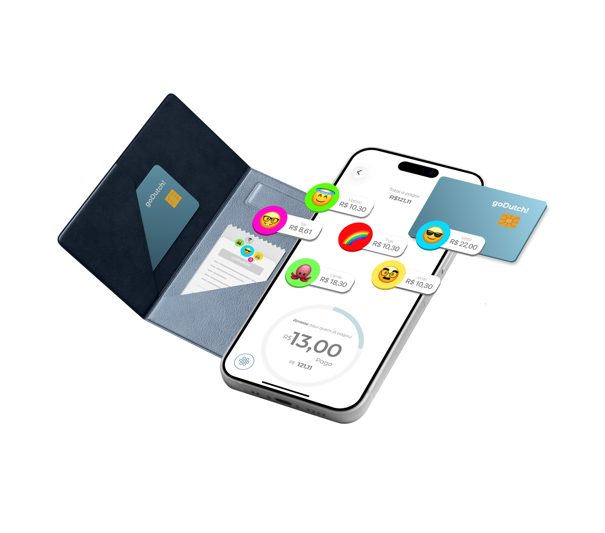
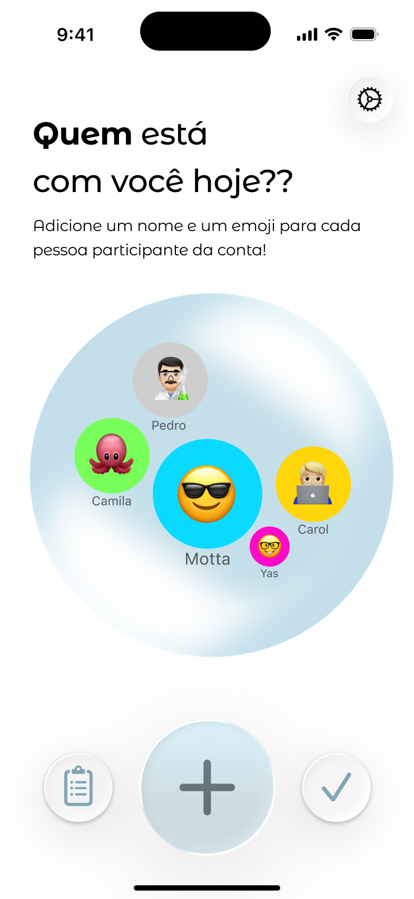
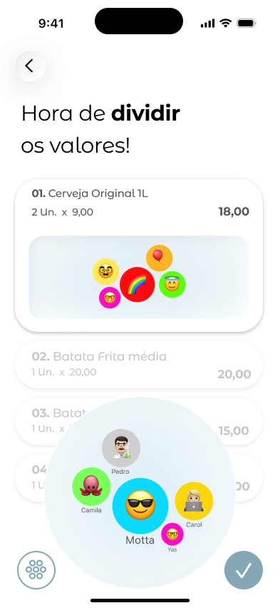
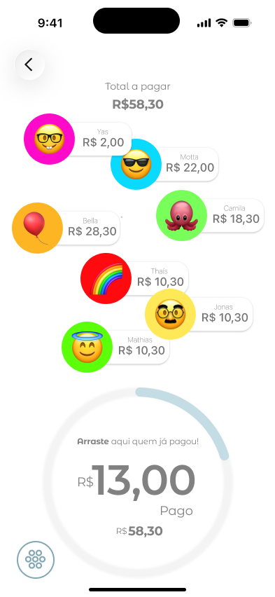
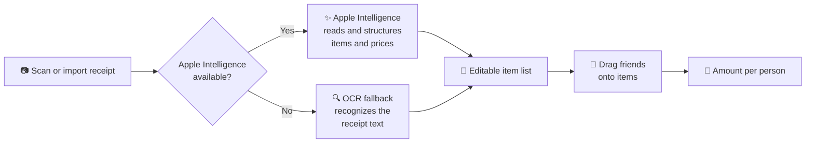
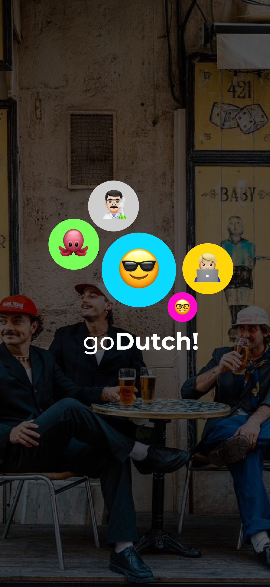

  

  

<h1 align="center">goDutch!</h1>

  <b>Split the bill with your friends in seconds — just scan the receipt.</b>

  

  
  
  
  
  
  
  

---

## About

Splitting the bill at the end of a night out usually means passing a phone around, typing every item into a calculator and — almost always — forgetting the service fee.

**goDutch!** turns that moment into something quick and fun. Add your friends as colorful emoji bubbles, scan the receipt and let **Apple Intelligence** read every item for you. Then drag each friend's bubble onto the items they shared, and goDutch! instantly shows how much each person owes. Only one person needs the app to split the whole table.

This is my **fourth app published on the App Store**, developed at the **Apple Developer Academy | Mackenzie** over 16 weeks by a team of 3 developers and 1 designer.

---

## Highlights

| | |
|---|---|
| ⭐ **5.0 rating** | 11 ratings on the App Store, all 5 stars |
| 📲 **73 downloads** | since launch |
| ⚡ **~75% faster** | splitting a bill takes ~15 seconds by scanning vs. ~1 minute typing items manually |
| 📱 **Works on every supported iPhone** | Apple Intelligence on compatible devices, with an OCR fallback for all iPhones running iOS 17+ |

> *"Muito simples, direto, rápido, e as animações são a cereja em cima do bolo!"* — App Store review

---

## How It Works

<table>
  <tr>
    <td align="center" width="25%">
      
    </td>
    <td align="center" width="25%">
      
    </td>
    <td align="center" width="25%">
      
    </td>
    <td align="center" width="25%">
      
    </td>
  </tr>
  <tr>
    <td align="center"><b>1. Who's with you?</b> Add each friend with a name and an emoji</td>
    <td align="center"><b>2. Scan the receipt</b> Use the camera, a photo from your library, or type items manually</td>
    <td align="center"><b>3. Split the items</b> Drag friends' bubbles onto each item they shared</td>
    <td align="center"><b>4. Settle up</b> See what each person owes and drag in whoever has already paid</td>
  </tr>
</table>

---

## Features

- **Emoji bubble profiles**: each person at the table is a colorful bubble with their name and an emoji of their choice
- **Receipt scanning with Apple Intelligence**: scan the receipt and the app identifies each item, its quantity and price automatically
- **OCR fallback**: on iPhones without Apple Intelligence, text recognition reads the receipt instead, so every user gets the scanning experience
- **Multiple input options**: scan with the camera, import a photo of the receipt from your library, or add items manually
- **Drag-and-drop splitting**: drag friends' bubbles onto the items they shared, and shared items are divided automatically
- **Amount per person**: a clear summary of how much each friend owes, service fee included
- **Payment tracking**: drag friends who have already paid into the payment ring and watch the remaining balance update
- **Only one phone needed**: the whole table can split the bill using a single device
- **Playful animations**: interactive, physics-based bubbles built with SpriteKit
- **Persistent storage**: data saved locally with SwiftData
- **Accessibility**: support for Dynamic Type and VoiceOver

---

## How Receipt Scanning Works

When the user scans a receipt, the app first checks whether **Apple Intelligence** is available on the device. Apple Intelligence requires an iPhone 15 Pro or later.

- **If it is available**, Apple Intelligence interprets the receipt and returns a structured list of items, quantities and prices.
- **If it is not available** (any iPhone before the iPhone 15 Pro), the app falls back to **OCR text recognition** to extract the items.

Either way, the user lands on the same editable list. This means the app supports every iPhone running iOS 17 or later instead of only the latest models.

---

## Accessibility

We wanted everyone at the table to be able to use goDutch!:

- **Dynamic Type**: text scales with the user's preferred text size
- **VoiceOver**: interface elements are labeled so the app can be used with Apple's screen reader

---

## Tech Stack

| Technology | Usage |
|---|---|
| **SwiftUI** | User interface |
| **Apple Intelligence** | Receipt interpretation on compatible devices |
| **OCR (text recognition)** | Receipt reading fallback for devices without Apple Intelligence |
| **SpriteKit** | Interactive bubbles and animations |
| **SwiftData** | Local persistence |
| **Git & GitHub** | Version control and team collaboration |

---

## Requirements

- **Xcode** 27 or later
- **iOS** 17 or later
- **iPhone 15 Pro or later** to use the Apple Intelligence scanning (other devices use the OCR fallback)
- A **physical device** is recommended to test the camera and receipt scanning

---

## Running the Project

1. Clone or download the repository
2. Open the `.xcodeproj` file in Xcode
3. Select a physical device (recommended) or a simulator
4. Press **Run (⌘R)**

---

## My Role

As one of the three developers on the team, I was responsible for:

- **Integrating Apple Intelligence** to read and interpret receipts
- **Building the OCR fallback** so the app works on iPhones without Apple Intelligence
- **Developing screens** in SwiftUI
- **Implementing persistence** with SwiftData
- **Managing the codebase**: merging branches and resolving merge conflicts across the team's work

---

## What We Learned

- Integrating **Apple Intelligence** into a real product and designing a graceful fallback for unsupported devices
- Working with **OCR** and turning unstructured receipt text into structured data
- Building playful, physics-based interactions with **SpriteKit** inside a SwiftUI app
- Using **SwiftData** for modern local persistence
- Building **accessible** interfaces with Dynamic Type and VoiceOver
- Taking an app from **ideation to App Store launch** in 16 weeks, using Agile practices
- Collaborating on a shared codebase with Git, including branch integration and conflict resolution

---

## Team

**Created by:** Thais Canguçu, Matheus Motta, Camila Parolin & Yasmin Mendes

---

  

  Made with 💙 at the <b>Apple Developer Academy | Mackenzie</b>

  

